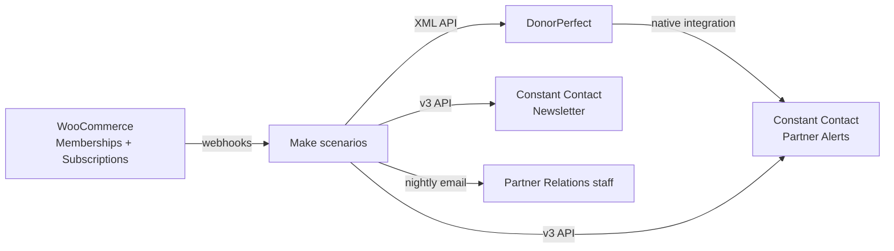

# Partner sync: WooCommerce → DonorPerfect → Constant Contact

A production integration that keeps a nonprofit's partner (member) records consistent across three systems without anyone re-keying data. Built in Make with nine scenarios, DonorPerfect's XML API, Constant Contact's v3 API, and WooCommerce Memberships webhooks.

**Status:** live since October 2026. The staff member who used to maintain the email lists by hand is observing the sync for a month before her manual lists are retired.

## The problem

Partners sign up and renew on a WordPress / WooCommerce site. Donor records live in DonorPerfect. Email and SMS go out from two separate Constant Contact accounts (one for partner alerts, one for the marketing newsletter). Before this project:

- New partners were added to DonorPerfect and the email lists by hand from order emails.
- Cancellations were not reliably removed from email lists, so some former partners kept getting mail and asked to stop all contact.
- Address changes made on the website never reached the CRM.
- Checkout answers (text-alert opt-in, how they heard about us, spouse name) sat in order emails and were copied in later, or not at all.

## The design in one line

**The website is the source of truth.** Make copies changes into DonorPerfect on the event that caused them, and nightly jobs reconcile anything that was missed. DonorPerfect's own Constant Contact integration plus Make keep both email accounts in step.

## What runs

| Trigger | Scenario | Does |
|---|---|---|
| Membership status webhook | **Status sync** | Writes Is-a-Partner, Partner Status, Membership Type, and dates to DonorPerfect. Applies the gifted-partner rule. Hands the customer to the checkout-answers scenario. |
| New membership webhook | **New partner** | Creates or matches the DonorPerfect record, fills title and phone, adds the partner to the Partner Alerts list immediately (and the SMS list if opted in). Emails Partner Relations. |
| Customer updated webhook | **Contact changes** | Pushes address and email changes to DonorPerfect and both Constant Contact accounts. Compares street + 5-digit ZIP only so spelling differences don't trigger churn. |
| Called by the two above | **Checkout answers** | Copies renewal checkout answers (DOB, spouse, how-heard, listen-via, text opt-in) into DonorPerfect. Fills empty fields only, except text opt-in where the website's latest answer always wins. |
| Nightly 11:00 PM | **Catch-up** | Re-posts the last 26 hours of membership and subscription events in case a webhook was missed. |
| Nightly 12:30 AM | **Newsletter lists** | Adds active partners to the Newsletter account's partner lists; paused and cancelled come off the partner list only. |
| Nightly 1:15 AM | **Full status check** | Website ↔ DonorPerfect status reconciliation. |
| Nightly 1:45 AM | **Partner Alerts lists** | Removals, Canceled/Paused list maintenance, and a plain-language list-count email. |
| Morning 7:00 AM | **Count check** | Emails the partner count in DonorPerfect vs. the website so drift is visible the same day. |

Full detail: [docs/scenarios.md](docs/scenarios.md).

## Rules the system enforces

These were decided with the staff who own the data, not by me alone. See [docs/decision-rules.md](docs/decision-rules.md).

- Never unsubscribe anyone in Constant Contact. Only remove from lists. Never delete contacts.
- Never overwrite a non-empty DonorPerfect field, with one exception: text-alert opt-in, where the website's most recent answer wins.
- No one is texted without consent. Once someone opts out, nothing more goes to that number.
- Pending-cancellation counts as active until the term ends.
- A brand-new partner shows up in the alerts list immediately, not overnight.
- Returning partners after 6+ months away go through the welcome sequence; routine renewals do not.

## Field mapping

[docs/field-mapping.md](docs/field-mapping.md) covers how WooCommerce order and membership fields map to DonorPerfect standard and user-defined fields and to Constant Contact list membership.

## Operating it

[docs/runbook.md](docs/runbook.md): the weekday morning check, what the nightly emails mean, how to tell a webhook miss from a logic bug, and how to patch a scenario without exposing keys.

## Python helpers

`tools/` holds small clients I use for checks and one-off fixes outside Make:

- `dp_client.py`: DonorPerfect XML API wrapper (query, find by email, save donor, set a flag).
- `cc_lists.py`: Constant Contact v3 helpers that add and remove list memberships without ever changing subscription status.
- `woo_memberships.py`: reads active memberships from the WooCommerce REST API.
- `reconcile.py`: produces the same website-vs-CRM gap report the morning scenario emails.

Run `pytest` for the unit tests (API calls are mocked).

## What I'd do differently

- Start with the reconciliation jobs, not the real-time ones. The nightly checks found the data problems that shaped every rule above.
- Compare addresses on street + ZIP from day one. The first version flagged every "St." vs "Street" as a change.
- Budget Make operations early. Nine scenarios with nightly full scans use credits fast; the catch-up window was tuned down from 7 days to 26 hours.

## Not in this repo

Scenario blueprints, connection IDs, webhook URLs, API keys, and any partner data. Scenario names and IDs in the live account differ from the descriptive names used here.
